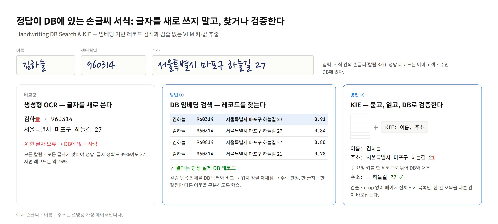
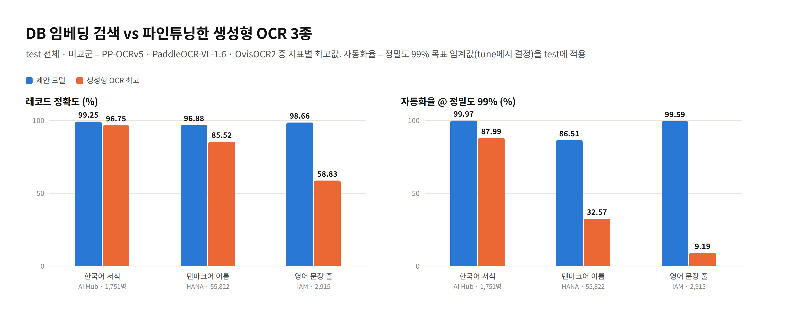
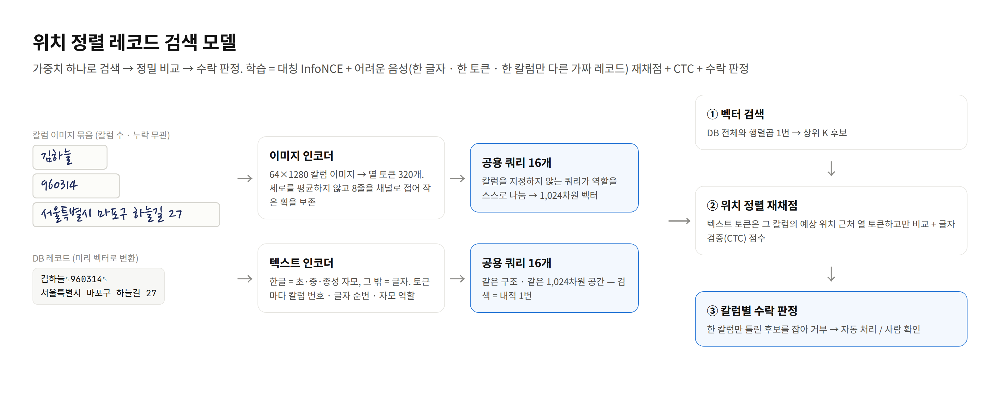
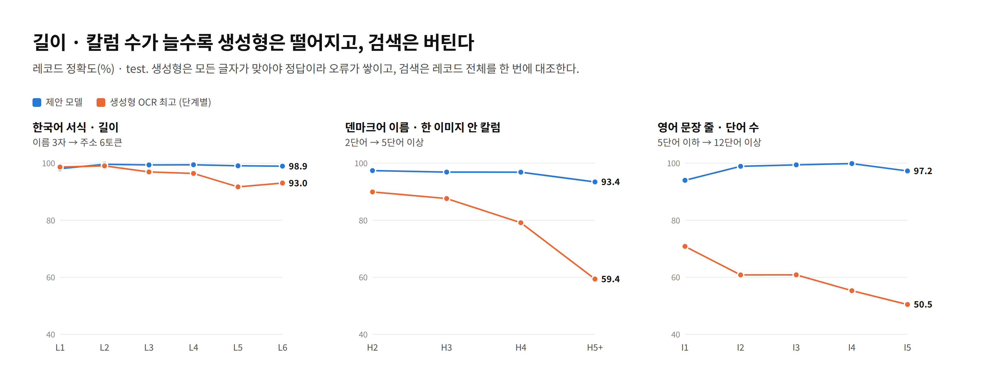
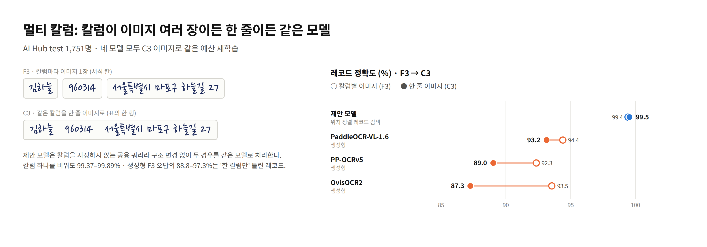
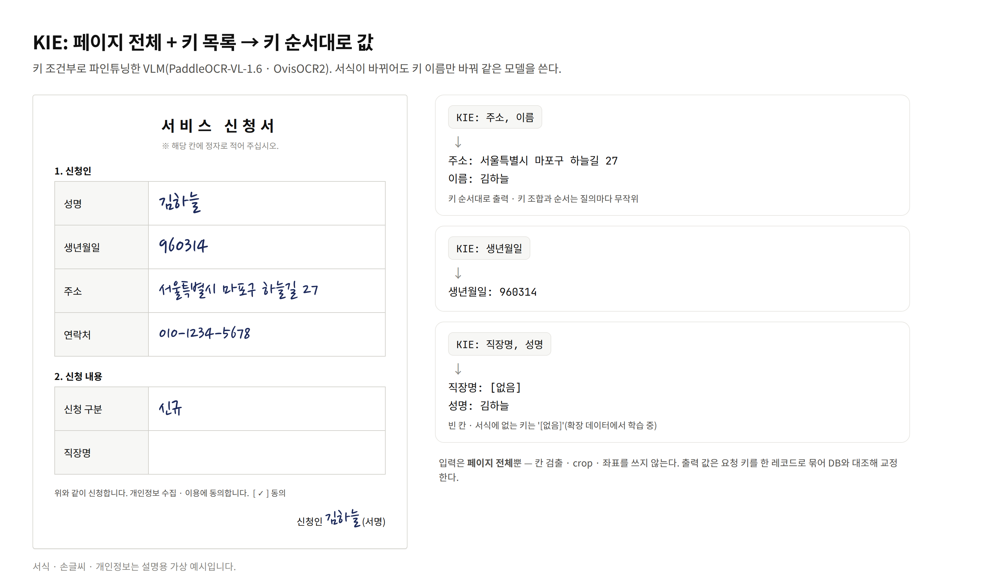
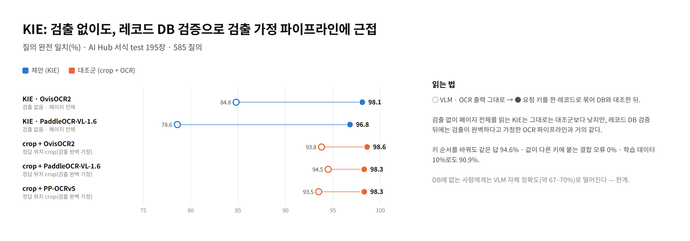

# 손글씨 DB 검색과 KIE

**Handwriting DB Search & KIE** — 정답이 이미 DB에 있는 손글씨 서식을, 글자를 새로 쓰는 OCR 대신 **DB로 찾거나 검증**해서 읽는다.



신청서 · 등록부의 이름 · 생년월일 · 주소는 대부분 고객 · 주민 DB에 이미 있는 값을 확인하는 일입니다.
생성형 OCR은 한 글자만 틀려도 "없는 사람"이 되고, 필드가 길고 칼럼이 많을수록 오류가 쌓입니다.
이 저장소는 DB를 인식 과정 안으로 넣는 두 방법을 담고 있습니다.

| | ① DB 임베딩 검색 | ② KIE (생성 + DB 검증) |
|---|---|---|
| 하는 일 | 칼럼 이미지 묶음을 벡터로 만들어 DB 레코드 중 정답을 **찾는다** | 서식 페이지 전체 + 키 목록 → VLM이 키 순서대로 값을 **생성**하고 레코드 DB로 **검증**한다 |
| 입력 | 칼럼 crop (이미지 여러 장 또는 한 줄) | 페이지 전체 (검출 · crop 없음) |
| 모델 | 직접 설계한 위치 정렬 레코드 검색 모델 | 키 조건부 파인튜닝 VLM (PaddleOCR-VL-1.6, OvisOCR2) |
| 코드 | [`formrec.retrieval`](src/formrec/retrieval) | [`formrec.kie`](src/formrec/kie), [`formrec.kie_general`](src/formrec/kie_general) |

> 상태: 논문 투고 전 중간 결과입니다. 수치는 바뀔 수 있습니다.

## 주요 결과



| 데이터셋 | 레코드 정확도 (제안 / 생성형 OCR 최고) | 자동화율 @ 정밀도 99% (제안 / 생성형 OCR 최고) |
|---|---:|---:|
| 한국어 서식 (AI Hub 053, 1,751명) | **99.25** / 96.75 | **99.97** / 87.99 |
| 덴마크어 이름 (HANA, 55,822) | **96.88** / 85.52 | **86.51** / 32.57 |
| 영어 문장 줄 (IAM, 2,915) | **98.66** / 58.83 | **99.59** / 9.19 |

- 비교군 = 같은 train으로 파인튜닝한 PP-OCRv5 · PaddleOCR-VL-1.6 · OvisOCR2(지표별 최고값). 세 데이터셋 모두 McNemar 짝 검정 p < 0.001.
- **자동화율** = tune 세트에서 정한 확신도 임계값(정밀도 99% 목표)을 test에 적용했을 때 사람 확인 없이 처리되는 비율.
- KIE: 검출 없이 페이지 전체를 읽고도 레코드 DB 검증 뒤 **98.1%**(OvisOCR2). 정답 위치 crop을 준 OCR 파이프라인은 98.3–98.6%.

전체 표와 한계는 [docs/results.md](docs/results.md)에 있습니다.

## ① DB 임베딩 검색 — 위치 정렬 레코드 검색 모델



- **멀티 칼럼 일반형**: 칼럼을 지정하지 않는 공용 쿼리 16개로, 칼럼 수 · 종류 · 누락 · 배치(이미지 여러 장 / 한 줄)를 몰라도 같은 가중치로 처리합니다.
- **해상도 보존**: 세로를 평균하지 않고 8줄을 채널로 접어 작은 획을 남깁니다. 한글은 자모 단위로 비교해 한 획 차이도 토큰 하나 차이가 됩니다.
- **어려운 음성 학습**: 한 글자 · 한 토큰 · 한 칼럼만 다른 가짜 레코드를 밀어내도록 학습하고, 칼럼별 수락 판정으로 DB 밖 레코드를 거부합니다.
- **빠른 추론**: DB는 미리 벡터로 바꿔 두고, 행렬곱 1번 + 상위 K 후보 정밀 비교로 끝납니다.





## ② KIE — 묻고, 읽고, DB로 검증한다



- 입력은 서식 페이지 전체와 키 목록뿐입니다. 키 조합과 순서는 질의마다 무작위이고, 출력은 키 순서대로 나옵니다.
- 요청된 키 값을 한 레코드로 묶어 DB와 대조하면(편집 거리 합 최소), 한 칸의 오독을 다른 칸이 바로잡습니다. DB 1등과 거리가 멀면 VLM 출력을 그대로 씁니다.
- 진행 중: 인쇄 항목명을 키로 쓰는 일반형 데이터(키 수백 종, 빈 칸 · 없는 키 = `[없음]`, 처음 보는 서식 분할), 우도 기반 레코드 검증.



방법의 자세한 설명은 [docs/method.md](docs/method.md)에 있습니다.

## 저장소 구조

```
src/formrec/
  common/       작업 공간 경로 · 레코드/단계 정의 · 분할 해시 · 자동화율 지표 · 입력 점검 · 자모
  retrieval/    ① 검색 모델: 토크나이저 · 모델 · 데이터/합성 음성 · 증강 · 사전학습 · 학습 · 평가 · 요약
  baselines/    비교군: PP-OCRv5(학습 · BN 선정 · 추론), VLM(PaddleOCR-VL · OvisOCR2 학습 데이터 · 학습 · 추론), 채점
  data_prep/    원천 데이터 → 분할표 · crop 묶음 · 캐시 · 검색 DB · 어휘
  kie/          ② KIE: 데이터 · VLM 학습/추론 · 레코드 DB 채점 · DB 밖 · 키 순서 · 우도 검증 · 영점 평가
  kie_general/  인쇄 항목명 OCR · 표 칸 기반 키-값 짝 · 일반형 KIE 데이터 · 채점
  ops/          GPU 작업 스케줄러 · 디스크 보호 · 실험 계획(전체 / 스모크)
scripts/        환경 · 서드파티 설치, 비교군 학습 셸, 작업 실행 래퍼 · 감시 루프
configs/        PP-OCRv5 · PaddleOCR-VL 학습 설정 템플릿
docs/           방법 · 데이터 · 결과 · 운영 · 리팩터링 검증 기록, README 그림(figures/)
tests/          단위 테스트 + 원본 대조 테스트(tests/legacy)
workspace/      작업 공간(데이터 · 캐시 · 가중치 · 결과) — 저장소에 넣지 않음
```

## 빠른 시작

```bash
# 1. 환경 (uv, Python 3.12). base = 데이터 · 채점, train = 제안 모델, paddle / pf / vllm / swift = 비교군 · KIE
bash scripts/setup_envs.sh base
bash scripts/setup_envs.sh train
bash scripts/setup_third_party.sh        # PaddleOCR · PaddleFormers 공식 저장소(고정 커밋)

# 2. 데이터: 원천 3종을 workspace/data/ 에 직접 내려받아 둔다 (docs/data.md)
export FORMREC_WORKSPACE=$PWD/workspace PYTHONPATH=$PWD/src
cd $FORMREC_WORKSPACE
python -m formrec.data_prep.build split      # 분할표 (앞 단계는 docs/data.md 순서대로)

# 3. 제안 모델: CTC 사전학습 → 데이터셋별 파인튜닝 → 선정 · 평가 → 요약
torchrun --nproc_per_node 4 -m formrec.retrieval.pretrain --name pretrain_ctc --steps 30000 --eval_every 2000
torchrun --nproc_per_node 4 -m formrec.retrieval.train --data xa --name xa_prop --init runs/x/pretrain_ctc/final.pt
python -m formrec.retrieval.evaluate --ds xa --name xa_prop --mode select
python -m formrec.retrieval.evaluate --ds xa --name xa_prop --mode eval
python -m formrec.retrieval.summary --data xa
```

전체 실험(사전학습 1 + 4모델 × 데이터셋 파인튜닝 + 평가 묶음 + KIE)은 작업 계획 하나로 돌립니다.
스케줄러가 GPU 수 · 의존 · 디스크 예상치를 보고 작업을 띄우고, 감시 루프가 디스크를 보호합니다. 반드시 지정할 환경변수는 `FORMREC_WORKSPACE` 하나입니다.

```bash
export FORMREC_WORKSPACE=/path/to/workspace
bash scripts/launch.sh        # 감시 루프 → 스모크 계획(모든 단계를 최소 데이터로) → 통과하면 실제 계획
# 계획을 직접 돌릴 때
scripts/run_job.sh sched_x --stall-min 60 -- "$FORMREC_WORKSPACE/envs/base/bin/python" -m formrec.ops.jobsched formrec.ops.plan_full
```

작업 순서 · 의존 · 디스크 단계 기준 · 실패 재시도는 [docs/operations.md](docs/operations.md)에 있습니다.

## 테스트와 리팩터링 검증

연구 코드를 공개용으로 정리하면서, 원본 코드와 출력이 같은지 단계마다 대조했습니다.

- 제안 모델: 기존 체크포인트 5개 strict 로드, 추론 경로 출력 차이 0, 학습 손실 · 기울기 동일, 요약표 바이트 단위 동일 — [docs/verification/retrieval.md](docs/verification/retrieval.md)
- 비교군 · 데이터 준비: 점수 파일 132개 · 분할표 · DB · 어휘 · 학습 데이터 동일 — [docs/verification/baselines_data.md](docs/verification/baselines_data.md)
- KIE · 운영: 채점 요약 · DB 밖 · 키 순서 결과 동일, 작업 계획 구조 동일 — [docs/verification/kie_ops.md](docs/verification/kie_ops.md)

```bash
PYTHONPATH=src python -m pytest -q tests                       # 단위 테스트
LEGACY_WORK=/path/to/original/code FORMREC_WORKSPACE=/path/to/workspace \
  PYTHONPATH=src python -m pytest -q tests/legacy              # 원본 대조(원본 코드 · 산출물이 있을 때만)
```

GPU 경로(분산 학습 · vLLM 추론 · 프레임워크 학습)는 원본 그대로 옮겼으며, 새 환경에서 처음 돌릴 때는 스모크 계획으로 먼저 확인하세요.

## 데이터

- [AI Hub](https://aihub.or.kr) 「대용량 손글씨 OCR 데이터」(053, 한국지능정보사회진흥원) — 이 연구는 해당 데이터를 활용했습니다.
- HANA: A HAndwritten NAme Database for Offline Handwritten Text Recognition
- IAM Handwriting Database 3.0 (RWTH Aachen 분할)

어느 데이터도, 그 파생물(분할표 · crop · 캐시 · 학습된 가중치)도 이 저장소에 포함하지 않으며 재배포하지 않습니다.
README 그림의 손글씨 · 이름 · 주소는 손글씨 글꼴로 그린 설명용 가상 예시입니다([docs/figures](docs/figures)).

## 라이선스

정해지지 않았습니다.
